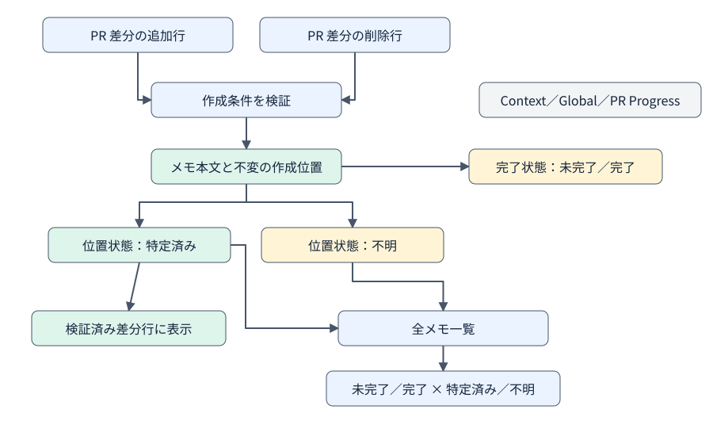

# Issue #23 設計書候補：PR 差分の行メモ

> **この文書は設計提案であり、未確定です。** 初版の対象を PR 差分の追加行・削除行の1行とし、手動完了を確認済み進捗から分けます。行に対応できなくなったメモは本文と作成時の位置を一覧に保持し、元ソース本文は保存しません。行への表示は対応を確実に確認できる場合に限ります。

## 1. 目的と範囲

PR の差分上にメモを付け、コードの変更後もメモ本文を参照できるようにする。メモは作成・編集・完了・再表示しても、既存の Context／Global の確認済み範囲と PR Progress に影響しない。

初版でメモを作成できる対象は、選択中 PR の現在の比較ペアにおける、実際に変更された追加行または削除行とする。

次の位置からはメモを作成しない。

- PR 差分の context 行
- 片側に対応するファイルがないときの仮想空行
- 複数行をまとめて扱う block 選択
- 現在選択中の PR と異なる比較ペアを表示する古い差分
- 現在の Context と一致しない差分行

通常エディタの任意行、複数行メモ、GitHub コメントとの同期は初版の対象外とする。

## 2. 実装方針



「作成条件を検証」で差分上の実在する変更行だけを受け付け、「メモ本文と不変の作成位置」を保存します。「完了状態：未完了／完了」と位置状態は別々です。「全メモ一覧」には未完了・特定済み、完了・特定済み、未完了・不明、完了・不明の4通りが含まれます。図に接続のない「Context／Global／PR Progress」は更新しません。

## 3. 実装詳細：識別子と行位置

既存の識別子と座標規約を利用する。`repositoryId` と PR 番号に結び付く `contextId` で保存先を識別する。PR 差分の `fileId` は差分スナップショット内でファイルを選ぶ識別子（現行では新パスがあれば新パス、なければ旧パス）であり、既存の永続レビュー状態が解決するファイル ID とは同一とみなさない。メモ作成時の side の正規化済みパスを別に保存する。

比較ペアの識別子 `originalDiffId` は `${baseSha}..${headSha}` とする。これは差分を識別する値であり、個々のメモの永続 ID ではない。各メモには独立した不透明な `noteId` を与え、異なるメモ間で一意にする。

作成時の位置情報には次を含める。

| 情報 | 用途 |
|---|---|
| `repositoryId`、PR Context の `contextId`、PR 番号 | repository と PR を識別し、別 Context への誤表示を防ぐ |
| 差分スナップショットの `fileId`、当時の side の repository 相対パス | その比較内のファイルと作成時の表示位置を記録する |
| `originalDiffId`、`baseSha`、`headSha` | 作成時の比較ペアを固定する |
| diff side と side の revision SHA | original／modified のどちらに付いたメモかを特定する |
| side の file blob OID（利用できる場合） | revision における file content の証拠とする |
| side 上の行番号 | 既存の diff 座標に合わせ、1始まりの `oldLine` または `newLine` を保存する |

作成時の位置は不変の記録とする。現在の差分に対応付けられた場合も、作成時の path、revision、side、行番号は上書きしない。現在位置は作成位置から導出する表示結果として扱う。元ソース行や file 本文は保存しない。

PR の行位置は、`DiffLine` の original 側 `oldLine` または modified 側 `newLine` を使って表す。確認済み状態が使うゼロ始まり半開区間と混同しない。

## 4. 表示・追従の規則

メモは現在の比較ペアの差分からのみ作成する。作成時の `repositoryId`、`contextId`、PR 番号、`originalDiffId`、side、revision、file identity と、現在の対象が一致することを確認してから操作を受け付ける。

side ごとに revision を別々に検証する。modified side の行は exact `headSha` の内容に、original side の行は exact `baseSha` の内容に対応しなければならない。side の内容または行の対応を検証できない場合は、その行にメモを表示しない。

original side のメモは、初版では `originalDiffId` が異なる比較ペアへ追従させない。modified side は、新しい head revision へ一意な行 mapping を証明できた場合に限り表示候補にできる。この初版案では modified の追従は BASE が同じ HEAD 更新に限る。新旧の HEAD・side のファイル証拠はメモの不変の作成位置から解決し、同じファイルに既存のレビュー状態がなくても検証対象に含める。元ソースを恒久保存しないため、証拠の取得不能時に正しい移動を推測しない。いずれも、現在の PR 差分にその side の変更行があり、現在の Context と比較ペアが検証済みであることを要する。再表示時にも対象 side の exact revision を確認する。

一意に証明できる rename は、新旧パスを結ぶ証拠としてのみ使う。改名の前後で差分の `fileId` が同じであることは前提にしない。曖昧 rename、copy、file 分割・統合、side 不一致、複数候補、証拠不足では自動移動しない。

### 状態遷移の候補

| 事象 | modified side のメモ | original side のメモ | 保持・表示 |
|---|---|---|---|
| HEAD のみ変更 | 一意に mapping でき、現在の PR 差分に変更行として残る場合だけ新しい head に表示候補を作る | 比較ペアが変わるため追従しない | 表示できないメモは一覧に残す |
| BASE のみ変更 | 比較ペアが変わるため新しい差分行へ移さない | `originalDiffId` が変わるため追従しない | 両方とも作成時位置を一覧に残す |
| BASE と HEAD の両方が変更 | 初版は自動移動しない | 別比較ペアへ追従しない | 一覧に保持 |
| 一意な rename | BASE が同じ HEAD 更新で、新旧パスと side revision の対応が一意な場合のみ、現在パス上の表示候補とする | 作成時と同じ比較ペアが復元された場合だけ検証する | 検証できない場合は一覧に残す |
| 対象行が変更対象外の context 行になった | 行に表示しない | 行に表示しない | 本文・作成位置・手動完了を一覧に保持 |
| 対象行が変更・削除された | 行に表示しない | 行に表示しない | 本文・作成位置・手動完了を一覧に保持 |
| 証拠不足、Git object／差分が取得不能 | 行に表示しない | 行に表示しない | 理由を添えて一覧に保持 |
| Context が切替・非表示、PR が終了 | 新しい Context に付け替えない | 新しい Context に付け替えない | 元 PR のメモ一覧から参照する提案 |
| file 本体が消え、メモだけが残る | 行に表示しない | 行に表示しない | メモ専用一覧に保持 |
| exact revision／比較ペアへ復帰 | revision と比較ペア、file identity、side、変更行座標を再検証できた場合だけ作成位置の行に再表示 | `originalDiffId` と BASE の exact revision を再検証できた場合だけ再表示 | それ以外は一覧に保持 |

BASE／HEAD 変更後の追従範囲、PR 終了後にどの一覧から参照するか、一意 mapping に必要な証拠は Issue 本文だけでは決まらない。上表は初版の保守的な提案である。

## 5. 完了状態と位置状態

完了状態と位置特定状態は独立した二軸とする。

| 完了状態 | 位置状態 | 表示 |
|---|---|---|
| 未完了 | 特定済み | 一覧に表示し、検証済みの差分行にも表示候補を出す |
| 完了 | 特定済み | 一覧に表示し、検証済みの差分行にも表示候補を出す。完了表示を付ける |
| 未完了 | 不明 | 一覧に表示する。差分行には表示しない |
| 完了 | 不明 | 一覧に表示する。差分行には表示せず、完了表示を維持する |

完了・未完了は利用者が明示して切り替える。行が変更・削除されたことや、PR の状態が変わったことから完了を推測しない。完了してもメモを削除・非表示にしない。

差分上の表示は利便用の導線とし、すべてのメモを参照する一覧を設ける。行が特定済みか不明かにかかわらず一覧に表示し、一覧から本文の閲覧・編集、完了／未完了の切替を行えるようにする。

## 6. 保存と競合

メモ状態は既存のレビュー状態と論理的に分離して保存する。PR Context と共通の保存ルートや atomic write、storage lock の仕組みは再利用できるが、メモ更新を Context／Global review state の更新として扱わない。

保存データの候補は次のとおり。

- store schema version と単調増加する store generation
- `noteId` をキーとする本文、完了状態、作成日時、更新日時
- 不変の作成位置と、side ごとの immutable revision evidence
- 現在位置の特定可否と理由は、その比較を検証する度に導出する。永続データの正本にはしない。

更新時は読み込んだ generation を期待値として CAS を行う。期待値が一致しないときは書き込まず、最新状態を再読込する。対象のメモ自体が更新されていなければ、新しい期待値で再適用できる。同一メモの競合は自動で上書きせず、入力内容を保持して利用者に選び直してもらう。古い snapshot や遅れて到着した同期内容で新しいメモを置き換えない。レビュー進捗の旧版復元・同期は独立したメモ store に作用しない。

未作成の store は正常な空状態として扱う。読み込み不能、破損、未知 schema、generation 不整合は空状態と区別し、既存データを退避または保持して上書きしない。保存に成功してからだけ操作の成功を表示する。

## 7. 具体例（仮の値）

以下は識別値と座標の関係を示す例であり、実 repository の値ではない。

```text
repositoryId = github.com/example/service
contextId = github-pr:github.com/example/service#42
PR = #42
baseSha = aaaaaaaaaaaaaaaaaaaaaaaaaaaaaaaaaaaaaaaa
headSha = bbbbbbbbbbbbbbbbbbbbbbbbbbbbbbbbbbbbbbbb
originalDiffId = aaaaaaaaaaaaaaaaaaaaaaaaaaaaaaaaaaaaaaaa..bbbbbbbbbbbbbbbbbbbbbbbbbbbbbbbbbbbbbbbb
diff fileId = src/cache.ts
path at creation = src/cache.ts
side = modified
side revision = bbbbbbbbbbbbbbbbbbbbbbbbbbbbbbbbbbbbbbbb
newLine = 18                 # 1-based modified-side line coordinate
noteId = note:7f3a...        # opaque persistent note ID, distinct from originalDiffId
note = 「再試行時に期限切れ token をどう扱うか確認」
completion = open
location = exact revision / pair / file / side / changed line verified
```

この行が後の revision で消えた場合、本文、`noteId`、作成時の `newLine`・path・revision は一覧に残す。行に再表示するのは、追従を許すケースで一意な mapping を検証し、現在の PR の exact side revision と差分変更行を確認できたときだけである。

## 8. 試験と受け入れ条件

各受け入れ条件を、対応する試験で確認する。

| 受け入れ条件 | 対応する試験 |
|---|---|
| **AC1.** 現在の PR Context の追加行・削除行から1行メモを作成・編集でき、context 行、仮想空行、古い比較、別 Context、block 選択からは作成できない。 | **T1.** 座標 side、変更行種別、Context／比較ペア一致を検証し、除外対象で作成 command を拒否する。 |
| **AC2.** メモ ID と比較ペア ID は異なり、作成時の repository／PR／file／side／revision／path／座標を不変に保持する。 | **T2.** 明示値を使って保存・再読込し、PR 差分 ID と `noteId` の非同一性、作成位置の不変性を検証する。 |
| **AC3.** HEAD／BASE の変更や rename 後に、一意な証拠がない行へ表示せず、本文と手動完了を一覧に保持する。 | **T3.** HEAD のみ、BASE のみ、両方、rename、削除、曖昧 mapping、証拠不足、メモのみ残る file の各ケースを表の期待結果と照合する。 |
| **AC4.** exact revision／比較ペアに復帰したときは再検証後にのみ行へ再表示し、original メモは異なる比較ペアへ追従しない。 | **T4.** A→B→A の revision 復帰と `originalDiffId` 変更を試し、exact pair の復元・別 pair の拒否を確認する。 |
| **AC5.** 完了状態と位置状態が独立し、4つの組合せすべてを一覧から参照できる。 | **T5.** 未完了／完了 × 特定済み／不明の4状態を作成し、一覧・差分表示・手動切替後も組合せを維持する。 |
| **AC6.** 競合、レビュー状態の復元・同期、未作成 store、破損・未知 schema でメモが誤って消えず、成功を誤表示しない。 | **T6.** stale CAS、遅延同期、review-state の巻戻し、store 不在、破損、未知 schema、atomic 保存失敗を注入し、再読込・保持・失敗表示を確認する。 |
| **AC7.** メモ操作によって既存の Context／Global の確認範囲・PR Progress が変わらない。 | **T7.** メモ作成・編集・完了・再表示の前後で review state と PR Progress が不変であることを検証する。 |

## 9. 未確定の設計判断

次は Issue #23 の本文で確定していないため、設計承認時に決める。

- 初版を PR 差分の追加行・削除行だけに限定すること。
- 完了を手動操作とし、確認済み進捗から独立させること。
- メモ本文と作成位置を行消失後も一覧に保持すること。
- 元ソース本文を保存しないこと。
- original メモは比較ペアを越えて追従させず、exact revision／比較ペアを確認できた場合だけ再表示すること。
- modified メモの HEAD 更新時に許す mapping の証拠と、BASE または両方が変わった場合の再表示規則。
- 変更されていない context 行になったメモは、初版案では一覧だけに残す。PR の終了後もメモを保持する前提で、閉じた PR の一覧にどこから入るかは未確定とする。
- blob OID 等の side evidence が得られない PR 取得方式で、メモ作成を許可するか。
